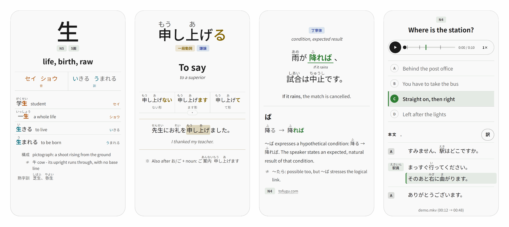
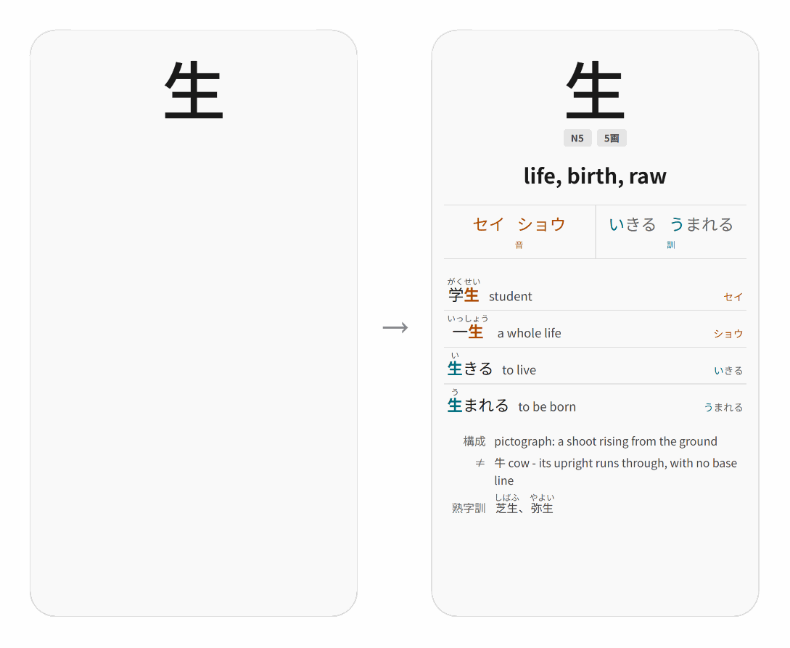
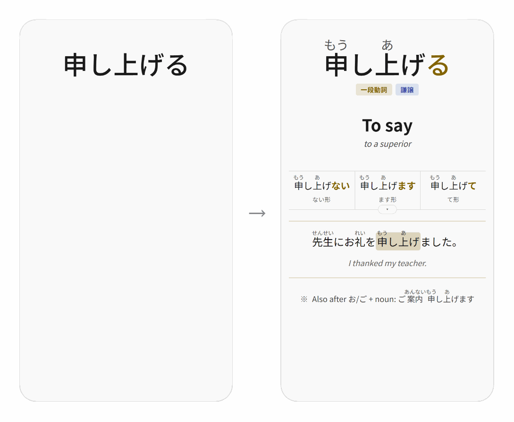
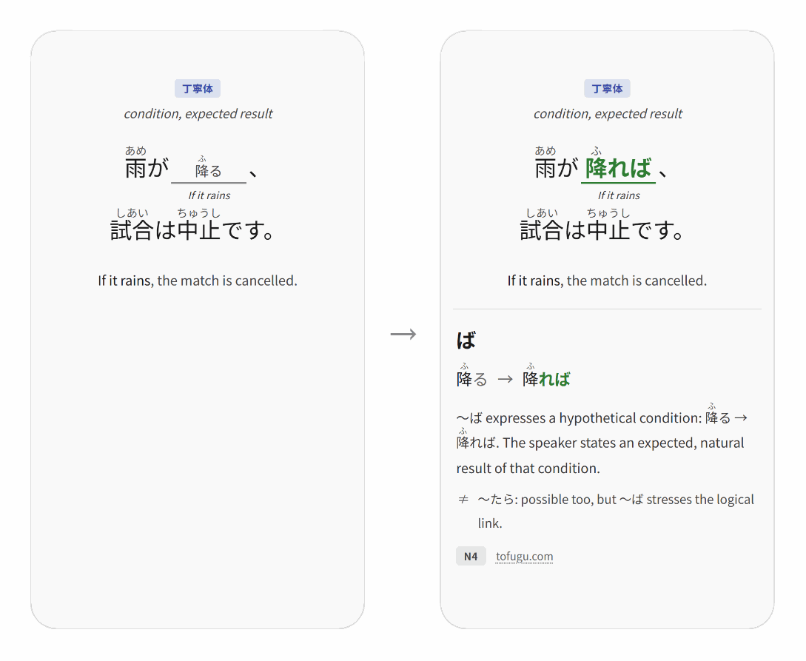
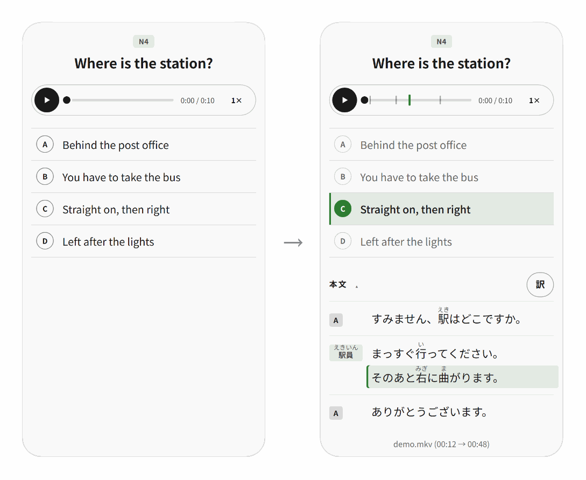
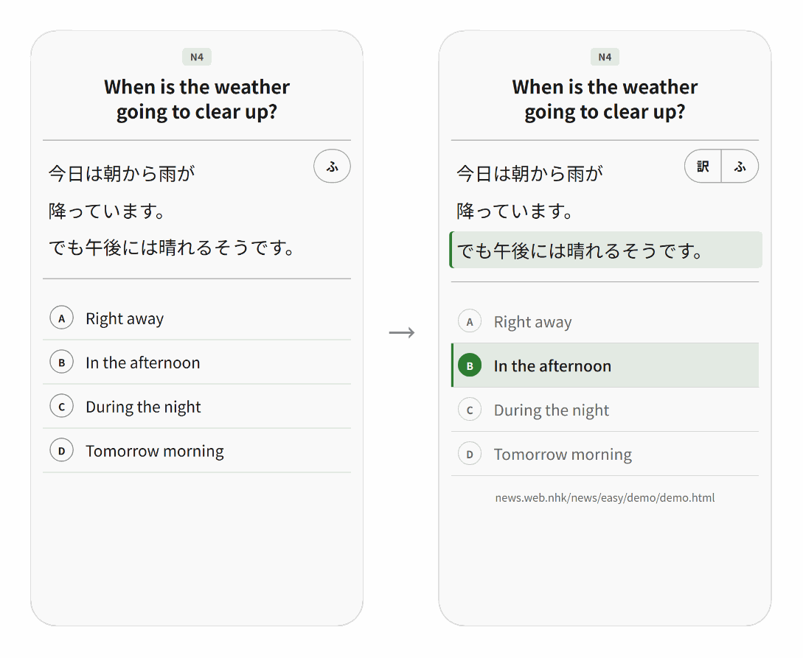
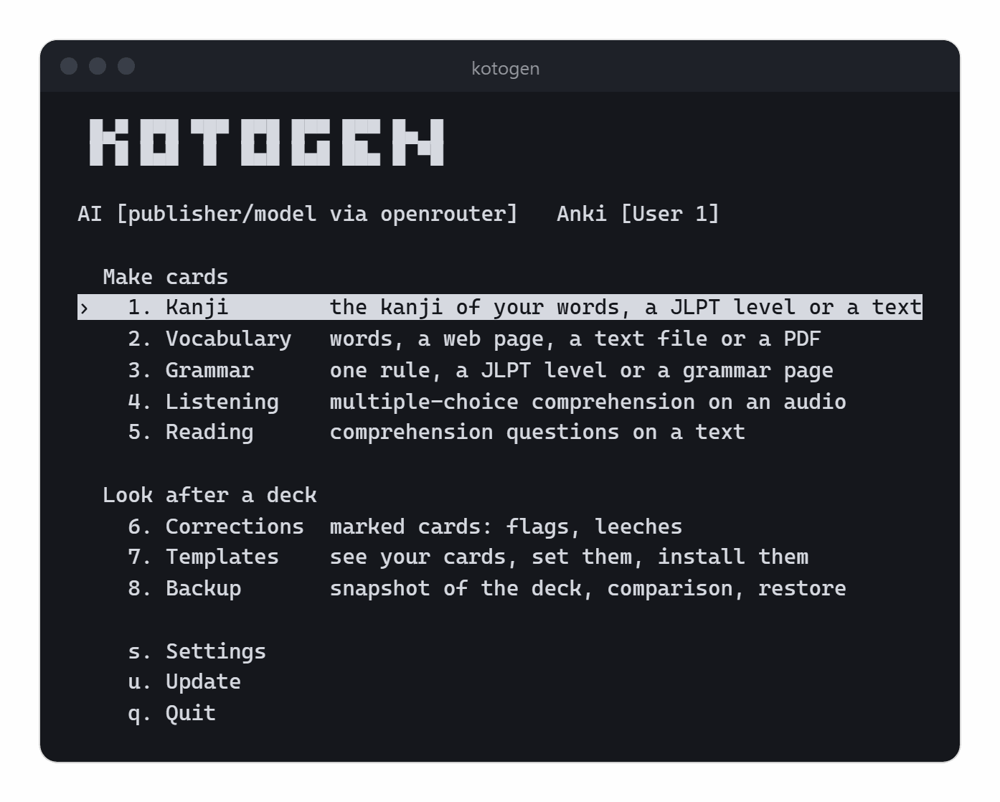
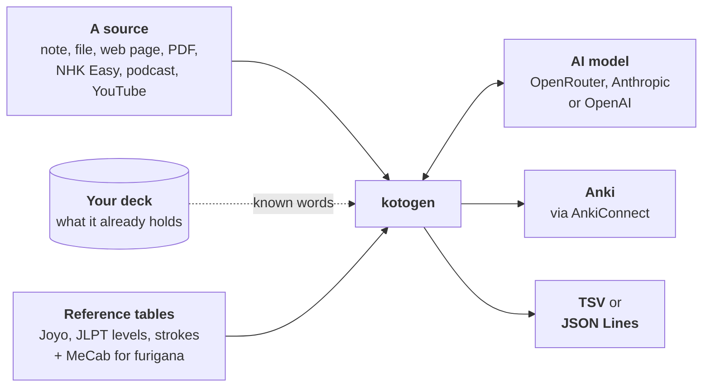

<div align="center">

# kotogen

**Anki cards for learning Japanese, written by an AI and checked against the reference tables.**

A word jotted down, an NHK Easy article, a podcast, a YouTube video, a PDF: kotogen turns it
into finished cards in your deck - readings, furigana, examples, sound and questions included.

[](https://github.com/delordt/kotogen/actions/workflows/ci.yml)

[](https://github.com/astral-sh/ruff)
[](LICENSE)

[](CONTRIBUTING.md#adding-a-language)

[Installation](#installation) | [Usage](#usage) | [The cards](#the-cards) | [Documentation](#documentation)

<br>

<picture>
  <source media="(prefers-color-scheme: dark)" srcset="docs/images/cards-dark.png">
  
</picture>

</div>

## Why kotogen

The AI writes the cards; the facts on them come from reference tables.

- **Readings from the tables, not from the model.** A kanji's readings, JLPT level and
  stroke count come from the Joyo table and the lists shipped with the program; a kanji
  outside the Joyo table gets the model's readings, tagged `Check::Reading`.
- **Furigana that always hold.** Every card uses the normalised `漢字[かな]` notation, and
  MeCab fills in any reading the AI left out.
- **Your deck comes first.** A kanji card shows your own words first, a JLPT level or a
  theme brings only the words your deck is missing, and what the deck already holds is
  dropped before the AI writes a card, so you never pay twice.
- **Any source.** A rough note, a file, a web page, a PDF, an NHK News Web Easy article, a
  podcast, a YouTube video, a local audio or video file, a free Tadoku book, a work of
  Aozora Bunko (as text or read aloud), the Irodori textbook, the official JLPT past papers.
- **A deck that is looked after.** `kotogen maintain` handles the cards you flag in Anki and
  the leeches; `kotogen ask` carries out a request in your own words. Both show each change
  for you to confirm, and take a backup first. See [Maintenance](docs/maintenance.md).
- **Cards you can shape.** The templates have settings (palette, readings, words,
  translation...) that you set in a [live preview](docs/card-templates.md#the-preview).
- **Three languages, and room for more.** The screens and the cards each use English,
  French or Japanese, set separately. Another language can be requested: see
  [Adding a language](CONTRIBUTING.md#adding-a-language).
- **No Anki needed to make cards.** The card generator is a library of its own: cards come
  out as a TSV file for Anki or as [JSON Lines](docs/library.md) for any other tool.

## The cards

Five note types, each with its own template. Front on the left, back on the right.

<table>
<tr>
<td width="52%">
<picture>
  <source media="(prefers-color-scheme: dark)" srcset="docs/images/kanji-dark.png">
  
</picture>
</td>
<td>
<h3>Kanji</h3>
<p><code>kotogen kanji</code> - one card per kanji: its meaning, its on and kun readings, and
words that use each reading, <b>taken from your own vocabulary first</b>. The back ends with
its components, the kanji it is confused with, and its special readings.</p>
<p>From a kanji or a word you type, the kanji of your vocabulary that have no card yet,
those of a JLPT level, or those of a web page or text file.</p>
<p><a href="docs/kanji.md">Kanji documentation</a></p>
</td>
</tr>
<tr>
<td>
<h3>Vocabulary</h3>
<p><code>kotogen vocab</code> - a clean card from a rough note (<code>suzushii - cool</code>,
<code>涼しい cool/refreshing</code>...): reading, furigana, context, example sentence, the
forms of a verb or an adjective, the class and register of the word. Two cards per note:
recognition and production.</p>
<p>From a word you type, a list of words in a file, the useful words of a web page, a text
file or a PDF (put back in dictionary form), or the words of a JLPT level or a theme that
your deck is missing.</p>
<p><a href="docs/vocabulary.md">Vocabulary documentation</a></p>
</td>
<td width="52%">
<picture>
  <source media="(prefers-color-scheme: dark)" srcset="docs/images/vocabulary-dark.png">
  
</picture>
</td>
</tr>
<tr>
<td>
<picture>
  <source media="(prefers-color-scheme: dark)" srcset="docs/images/grammar-dark.png">
  
</picture>
</td>
<td>
<h3>Grammar</h3>
<p><code>kotogen grammar</code> - cloze sentences. The front shows the sentence with a gap
on the target form, its translation and hints; the back shows the rule, the transformation,
and what sets the rule apart from similar ones.</p>
<p>From a rule you name (its JLPT level is detected), a file of rules, the rules of a JLPT
level that your deck is missing, or the rule a grammar page explains.</p>
<p><a href="docs/grammar.md">Grammar documentation</a></p>
</td>
</tr>
<tr>
<td>
<h3>Listening</h3>
<p><code>kotogen audio</code> - multiple-choice questions on a passage, with its transcript
in furigana, speaker by speaker. <b>Click a line of the transcript to play from there.</b></p>
<p>From a local audio or video file (transcribed by Whisper, or read from a subtitle file
next to it), an NHK Easy article, a podcast episode, a YouTube video, an Irodori lesson, the
JLPT past papers or a reading from 青空朗読. With <code>--video</code>, the card keeps the
picture and plays a clip of the passage.</p>
<p><a href="docs/listening.md">Listening documentation</a></p>
</td>
<td>
<picture>
  <source media="(prefers-color-scheme: dark)" srcset="docs/images/listening-dark.png">
  
</picture>
</td>
</tr>
<tr>
<td>
<picture>
  <source media="(prefers-color-scheme: dark)" srcset="docs/images/reading-dark.png">
  
</picture>
</td>
<td>
<h3>Reading</h3>
<p><code>kotogen reading</code> - comprehension questions on a text, its furigana hidden
until you ask for them: an NHK Easy article, a web page or text file, a work of Aozora
Bunko, the texts found in a PDF, or a text written on the words your deck is learning.</p>
<p>A book - a PDF, page images, or the URL of a free <a href="https://tadoku.org/japanese/free-books/">Tadoku</a>
book - can also be read <b>as a mini-book</b>: the card shows the pages themselves, to turn
and zoom into.</p>
<p><a href="docs/reading.md">Reading documentation</a></p>
</td>
</tr>
</table>

## The assistant



Run `kotogen` without arguments to open the assistant: numbered menus you move through with
the arrow keys. The top line shows the AI model and the Anki profile the cards will go to.
Entries that cannot run yet (no API key or model, Anki closed) are greyed out; choosing one
says what is missing and how to fix it.

On the first launch, if the API key, the model, Anki or a note type is missing, a
**getting-started guide** opens: one page each for the languages, the API key, the model,
Anki and its note types, and the optional modules.

Each screen builds a command line. With the verbose setting on (**v** in the settings), the
assistant prints it after running it, so you learn the command line as you go.

See [Interactive mode](docs/interactive.md).

<br clear="right">

## How it works



The model writes the translations, examples, questions and explanations, as JSON. kotogen
checks the answer, adds the facts from its own tables, and then writes the cards. A run that
calls the AI ends with what it cost.

## Installation

Python 3.10 or later.

On Windows, in PowerShell:

```powershell
git clone https://github.com/delordt/kotogen.git
cd kotogen
py -m venv .venv
.venv\Scripts\Activate.ps1
python -m pip install -U pip
pip install -e .
```

On Linux and macOS:

```bash
git clone https://github.com/delordt/kotogen.git
cd kotogen
python3 -m venv .venv
source .venv/bin/activate
python -m pip install -U pip
pip install -e .
```

If PowerShell refuses to run `Activate.ps1`, allow local scripts once with
`Set-ExecutionPolicy -Scope CurrentUser RemoteSigned`. On Debian and Ubuntu, `python3 -m venv`
needs the `python3-venv` package. The `python3` of macOS (`/usr/bin/python3`) may be older
than 3.10: install Python 3.10 or later from [python.org](https://www.python.org/downloads/)
or Homebrew. The pip upgrade matters on Python 3.10.0 to 3.10.2: the pip they come with is
older than 21.3, the first that installs a project with `-e` from its `pyproject.toml` alone.

> [!IMPORTANT]
> Keep the `-e`: the environment then runs the code in `src/` rather than a copy of it.
> Without it, a `git pull` updates the sources but the program silently keeps running the
> old code, and `kotogen update` and `kotogen deck install` fail: they need the clone.

<details>
<summary>Checking which code Python really loads</summary>

<br>

`python -c "import kotogen; print(kotogen.__file__)"` must print a path inside `src/`, not
`site-packages`. If it does not, delete the `build/` folder if there is one, then run
`pip install -e .` again (a leftover `build/` folder can bring back deleted files).

</details>

`pip install -e .` also installs fugashi and unidic-lite (MeCab and its dictionary, which
fill in missing furigana); the default provider, OpenRouter, needs nothing more. The optional
features are pip extras that **you do not have to install yourself**: on the first run, the
program lists what is missing and its download size, and installs it if you accept. See
[Optional modules](docs/global-options.md#optional-modules) and the `KOTOGEN_INSTALL`
setting.

<details>
<summary>The extras, for those who prefer to install them by hand</summary>

<br>

Each line is typed in the kotogen folder, with its virtual environment active.

| Extra | Installs | Needed for |
|---|---|---|
| `pip install -e ".[audio]"` | openai-whisper | `audio` on local files (+ FFmpeg: `winget` / `apt` / `brew install ffmpeg`) |
| `pip install -e ".[nhk]"` | playwright | NHK Easy articles in `audio`, `vocab` and `reading` (+ `playwright install chromium`, `--with-deps` on Linux; + FFmpeg for the audio; with `[audio]`, the sound is cross-checked with the text of the site) |
| `pip install -e ".[youtube]"` | yt-dlp | `audio` on a YouTube channel or URL (+ FFmpeg) |
| `pip install -e ".[pdf]"` | pypdfium2 (5 or later), pillow, numpy | `reading` as a mini-book (the pages of a PDF rendered as pictures), and the figures of the JLPT past papers |
| `pip install -e ".[anthropic]"` | anthropic | `--provider anthropic` |
| `pip install -e ".[openai]"` | openai | `--provider openai` |
| `pip install -e ".[dev]"` | pytest, ruff | running the tests and the linter |

**FFmpeg is never installed for you**: it is a system package, not a pip package. The first
run shows the command for your system. After `winget install ffmpeg` on Windows, open a new
terminal: the one it ran in may not see `ffmpeg` on its PATH yet.

</details>

### API key

The getting-started guide has an **API key** page that says where to get a key, takes it
without showing it, and saves it; later, **s** (settings) then **k** does the same. On the
command line, a command asks for the key if none is set; outside a terminal it stops
instead, naming the variable to set and the file to set it in. To get a key:
on [openrouter.ai](https://openrouter.ai), **Keys > Create key**.

By hand, the key is one line in a text file:

```dotenv
OPENROUTER_API_KEY=sk-or-...
```

With `--provider anthropic` or `openai`, the line is `ANTHROPIC_API_KEY=sk-ant-...` or
`OPENAI_API_KEY=sk-...`.

The file is `.env` at the root of the repository or `secrets.env` in the configuration
folder (`~/.config/kotogen/` on Linux). The program saves a key to `.env` when that file
exists, otherwise to `secrets.env`, with mode `0600`. See
[Where the settings live](docs/global-options.md#where-the-settings-live) for the other
settings and their order of priority, and
[When the AI falters](docs/global-options.md#when-the-ai-falters) for AI failures during a
run.

### AI model

kotogen comes with no model chosen, and recommends none: models come and go faster than its
releases. The guide's **Model** page, or **s** then **m** later, lists what each provider
serves today: the OpenRouter catalogue with the price of a typical generation, or the models
Anthropic and OpenAI serve to your key. The choice is saved, and `--model` overrides it for
one run. Until a model is chosen, the commands that call the AI (`vocab`, `grammar`, `kanji`,
`audio`, `reading`, `maintain`, `ask`, `rework`; `maintain --scan` calls none) stop before
doing any work and say how to choose one. On the first run in an environment, the question
about the [optional modules](docs/global-options.md#optional-modules) still comes first.

### Keeping it up to date

```bash
kotogen update                           # the sources, then the modules installed
kotogen update --check                   # what is waiting, without touching anything
```

`kotogen update` fetches the repository and fast-forwards your clone (**u** in the menu does
the same), then upgrades the installed extras. If the card templates changed, it says so:
`kotogen deck install` carries them into Anki. `kotogen --version` prints the running
version. Start `kotogen` again after an update: the process that ran it still holds the old
code.

<details>
<summary>The two rules it keeps to</summary>

<br>

- **A fast-forward, never a merge.** If the branch has commits of its own, or local changes
  that the incoming commits would overwrite, nothing is taken and git's reason is printed.
- **It upgrades what is installed, and installs nothing new.** The extras you have are
  brought to their latest version (an old `yt-dlp` stops downloading when YouTube changes);
  those you declined stay out. `pip install -e .` runs again only when the update changed
  `pyproject.toml`, which is when a dependency was added.

</details>

## Usage

Once the package is installed, the `kotogen` command is available (`python -m kotogen` works
too). A run writes the cards to a TSV file to import into Anki, or sends them into Anki with
`--send` (through AnkiConnect), keeping the TSV in its cache folder. With `--format json`, it
writes [JSON Lines](docs/global-options.md#json-lines-output) for any other tool instead.

```bash
kotogen                                  # interactive assistant
kotogen vocab "涼しい cool/refreshing"    # one vocabulary card
kotogen vocab jlpt --level N4            # the N4 words the deck is missing
kotogen grammar "〜てください" --count 5   # 5 cloze sentences
kotogen audio nhk                        # listening questions on the latest NHK Easy articles
kotogen audio teppei                     # latest episode of a podcast, cut into extracts
kotogen audio teppei-original --episode 42   # or a given episode, to work through an archive
kotogen audio onomappu                   # latest video of a YouTube channel, subtitles reused
kotogen reading textbook.pdf             # questions on the texts of a PDF
kotogen kanji deck                       # the kanji of your words that have no card yet
kotogen maintain --scan                  # what is waiting in the deck
kotogen deck install                     # put the note types into Anki
kotogen update                           # bring the program itself up to date
```

Each command is documented in [`docs/`](docs/); `kotogen <command> --help` lists its options.

### From another program

Anki is needed only to send cards and to read or change the deck: the card generator is a
library of its own, usable from another program without Anki. On the command line, the
first command below writes cards as JSON Lines, each with an `id` derived from its content;
the second writes the AI's proposals for the same cards to another file, under the same
`id`s, and changes nothing:

```bash
kotogen vocab --file words.txt --format json --output cards.jsonl
kotogen rework cards.jsonl --task simplify --output proposals.jsonl
```

In a JSON Lines run, the file named by `--output` is also the run's memory: what it already
holds is not made again. [From another program](docs/library.md) covers the Python API, the
layout of both files and the line between the library and the Anki adapter.

### Importing into Anki

`--send`, `kotogen deck install` and the commands that work on the deck (`maintain`, `ask`,
`backup`) need the [AnkiConnect](https://ankiweb.net/shared/info/2055492159) add-on (code
`2055492159`): install it, then restart Anki. Without it, import the TSV by hand:
**File > Import**, the generated `.tsv`, the **Tab** separator and the right note type,
which you create first (see
[Getting the templates out without Anki](docs/card-templates.md#getting-the-templates-out-without-anki)).

### Languages

The screens and the cards each have their own language setting, both **English** by
default.

- **The screens**: `KOTOGEN_LANG=fr` (French) or `KOTOGEN_LANG=ja` (Japanese), or the `l`
  key in the settings. The `--help` of the command line stays in English: the option names
  and values it lists are what you type.
- **The cards** (translations, questions, explanations): `all.lang=fr` or `all.lang=ja` in
  `templates.env`, or the `g` key in the settings. In Japanese, a word is explained in
  easier Japanese, the text of a reading or listening card is reworded line by line in
  easier Japanese, and the questions are asked as the JLPT asks them.

The **schema** is English in every language: the names of the note types, fields and cards
(`Vocabulary`, `Translation`...) and the **tags** (`Level::N4`, `Check::Reading`). A search
finds the same cards whatever the setting, and one collection can hold cards in several
languages. See [Card templates](docs/card-templates.md) and
[The two languages](docs/global-options.md#the-two-languages).

A new language is requested in an issue and written in this repository, and needs a reader
of that language to report what reads wrong. For the screens it is one translation table;
for the cards, a folder of instructions and a few entries in the code. See
[Adding a language](CONTRIBUTING.md#adding-a-language).

## Documentation

The detailed documentation is in [`docs/`](docs/):

| Page | What it covers |
|---|---|
| [Interactive mode](docs/interactive.md) | The assistant launched without arguments: menus, settings, catalogue of AI models |
| [Kanji](docs/kanji.md) | `kotogen kanji`: a card per kanji, your words first, readings from the Joyo table |
| [Vocabulary](docs/vocabulary.md) | `kotogen vocab`: words, lists, JLPT levels, themes, decomposition, words already known |
| [Grammar](docs/grammar.md) | `kotogen grammar`: cloze sentences for a rule, a JLPT level or a grammar page |
| [Listening](docs/listening.md) | `kotogen audio`: questions on an audio or video file, NHK Easy, a podcast, YouTube, Irodori, the JLPT past papers or 青空朗読 |
| [Reading](docs/reading.md) | `kotogen reading`: comprehension questions, and the mini-book |
| [Sources](docs/sources.md) | Web page, text file, PDF document: what `vocab` and `reading` make of them |
| [Maintenance](docs/maintenance.md) | `kotogen maintain`: flags, duplicates, leeches; `kotogen rework` on a file of cards |
| [Asking](docs/ask.md) | `kotogen ask`: a request in your own words, carried out by the AI on the deck |
| [Card templates](docs/card-templates.md) | `kotogen deck install`: putting the note types into Anki, customising the cards |
| [Backup](docs/backup.md) | `kotogen backup`: snapshot of the deck, comparison, restore |
| [Global options](docs/global-options.md) | Shared options, languages, optional modules, cost, currency, caching, a command that stops, output folder, decks, connection to Anki |
| [AI instructions](docs/prompts.md) | Editing the instructions sent to the model, one Markdown file per instruction |
| [From another program](docs/library.md) | Cards without Anki: JSON Lines in and out, the library from Python, the line between the two layers |

## Development

Kotogen was developed privately until version 1.0.0, its first public release: the history
of this repository starts there.

<details>
<summary>Repository layout</summary>

<br>

```
kotogen/
├── src/kotogen/           The generator (Python package, kotogen CLI)
│   ├── cli.py             Entry point and arguments: puts the library and the adapter together
│   ├── interactive/       Interactive assistant (launch without arguments), a module per screen
│   ├── i18n.py            Interface language (lookup tables in locales/)
│   ├── ai_client.py       AI providers (OpenRouter by default, Anthropic, OpenAI)
│   ├── catalogue.py       Models each provider serves (OpenRouter's with today's prices, cached)
│   ├── keyboard.py        Reading one key without Enter (arrows, Escape) per OS
│   ├── furigana.py        Furigana pipeline (MeCab completion, normalisation, spacing)
│   ├── kanji_word.py      Spots the lone kanji that are not words (語, 的...)
│   ├── kanji_table.py     What a kanji is: readings, JLPT level, strokes (local tables)
│   ├── choices.py         The choices about the cards (templates.env), all.lang among them
│   ├── known.py           What already exists, asked of the deck, a JSON Lines file or nothing
│   ├── exporter.py        TSV / JSON Lines written and read back, the closing summary of a run
│   ├── rework.py          kotogen rework: the maintenance of a JSON Lines file, written down
│   ├── locales/           Translations of the interface (fr.json, ja.json)
│   ├── prompts/<lang>/    The instructions sent to the model (one .md per instruction),
│   │                      and structure/, the instructions answered in JSON
│   ├── generators/        vocab, grammar, audio, reading, kanji, nhk (News Web Easy),
│   │                      podcast, youtube, irodori, jlpt_papers, aozora,
│   │                      whisper (transcription), audio_files (the files of a run),
│   │                      audio_split, cuts, announcements (a collection cut into passages),
│   │                      pdf_source (PDFs read by the model, vision),
│   │                      pdf_pages (pages rendered as pictures for the mini-book),
│   │                      pdf_web (PDF fetched from a URL, free Tadoku books),
│   │                      text_source (any web page or text file),
│   │                      sources (routing of the sources, shared by the generators)
│   ├── maintenance/       What to propose for a card: review (flags, duplicates), leech,
│   │                      derive, listening - the logic, with no collection read or written
│   └── anki/              The Anki adapter, the one part that knows Anki: connect (AnkiConnect),
│                          deck (what it holds), send and media, notetypes and templates,
│                          backup, preview, ask, maintain/ (the notes read, shown, written:
│                          marks, flag_pass, lone_kanji, review...)
├── docs/                  The detailed documentation
├── templates/             Anki card templates (one folder per note type)
│   ├── vocab/             recognition/ and production/: front.html, back.html, style.css
│   ├── grammar/           a single cloze note type
│   ├── audio/
│   ├── reading/
│   └── kanji/             recognition/ (each folder also has a context.md describing the card)
└── tests/                 Unit tests + `card_bench.py`, which opens the cards in the
                           browser, `codec_bench.py`, which checks Anki's video codecs,
                           and `readme_images.py`, which takes the pictures of this README
```

Each note type has a folder in `templates/` with the HTML and CSS of its cards and a
`context.md` that documents its fields and behaviour; `templates/common.css` is shared by
all of them. `kotogen deck install` puts them into Anki (see
[Card templates](docs/card-templates.md)). The files carry markers for the card settings:
to create the note types by hand, export the rendered templates from the **Templates** menu
rather than copying the files.

</details>

### Tests

```bash
pip install -e ".[dev,pdf]"
pytest
ruff check src tests
```

The CI runs the suite on Windows and Linux with Python 3.10, 3.13 and 3.14, on macOS with
Python 3.13, and ruff in a separate job. Without the `pdf` extra, the tests of the PDF pages
and figures are skipped. The suite also enforces the repository's own rules: every
`kotogen` example of the documentation goes through the real parser, every link resolves,
every sentence of the screens has its French and Japanese translations, and a note type
already shipped can only gain fields and cards.

Without Playwright's Chromium, the tests check how the templates are built. With it (the
`nhk` extra and `playwright install chromium`, which the CI does not install),
`tests/test_templates.py` also runs the cards in a copy of the page Anki desktop shows them
in, its own style sheets included, kept from card to card as Anki keeps it. What a card does
under your hand (the shuffled choices, the click that replays a line, the pages of a
mini-book) is checked by eye in the
[preview](docs/card-templates.md#the-preview), which renders the real `templates/` in
the browser, filters (`furigana`, `kanji`, `cloze`) and `FrontSide` included, with the card
settings beside the cards. It opens from the assistant (the **Templates** menu, then
**Preview**), or directly with `tests/card_bench.py`:

```bash
python tests/card_bench.py                          # every sample, in tabs
python tests/card_bench.py audio                    # just one, to get straight to the point
python tests/card_bench.py audio --field Timecodes= # check a degradation
```

The page is served on `127.0.0.1` while the script runs, and a refresh reads the templates
again. Pytest does not collect this script.

`tests/readme_images.py` takes the pictures of this README again, into `docs/images/`: the
faces of the preview at phone size in both palettes, and the main menu, run against a
stand-in for AnkiConnect. It needs the `nhk` and `pdf` extras (Playwright with its
Chromium, Pillow) and FFmpeg. The choices are shuffled with a fixed seed, so unchanged
templates give unchanged pictures. Run it after changing a card or a menu entry:

```bash
python tests/readme_images.py
```

<details>
<summary>Video codecs in Anki: <code>tests/codec_bench.py</code></summary>

<br>

The preview runs in a browser, not in Anki's WebView, so the video codecs Anki plays are
tested in Anki itself: `tests/codec_bench.py` adds a card with two clips, one in the
generator's profile and one in H.264, and shows under each whether it played (frame
decoded, sound only, refused, or no answer). Anki desktop refuses H.264, as Qt WebEngine is
built without the proprietary codecs: hence the VP9/WebM of `--video`. Run it again on
another machine or after an Anki update.

```bash
python tests/codec_bench.py            # lays the card (deck Kotogen::Codecs)
python tests/codec_bench.py --remove   # removes the card, the deck and the clips
```

</details>

### Contributing

Kotogen does not accept pull requests. Report a bug, a wrong card or an idea as an
[issue](https://github.com/delordt/kotogen/issues) and describe it: changes are made here
from your description. The rules the code follows (English throughout, every screen
sentence through the translation catalogue, note types that change by addition only) are in
[CONTRIBUTING.md](CONTRIBUTING.md). Report security issues as [SECURITY.md](SECURITY.md)
explains.

## Licence

Copyright (c) 2026 Tom Delord

This project is distributed under the [GNU AGPL-3.0-or-later](LICENSE) licence. In short:
free to use, modify and redistribute, provided that any modified version that is distributed -
including offered as an online service - is published under the same licence.

The reference tables of `src/kotogen/data/` are lists of facts, under the licence of the
project. Two of them are extracted from the Joyo kanji table (常用漢字表) of the Agency for
Cultural Affairs, a cabinet notice, which is not a copyrighted work: `joyo_kanji.tsv` and
`joyo_special_readings.tsv` cite it at their head, as its publisher asks. The others - the
JLPT levels of the words, the grammar points and the kanji, and the number of strokes of each
kanji - are settled by consensus.
